# Flutter and Dart Lab Experiments 🚀

A collection of 12 practical experiments covering Dart programming and Flutter application development. This repository includes hands-on exercises on programming fundamentals, UI design, responsive layouts, navigation, state management, API integration, local storage, animations, and a mini project.

## 📚 Experiments

| No. | Experiment | File Name | Concepts Covered |
|:---:|---|---|---|
| 01 | Dart Language Basics | `experiment_01_dart_basics.dart` | Variables, data types, operators, functions, and control flow |
| 02 | Flutter Widgets and Layouts | `experiment_02_widgets_layouts.dart` | Text, Image, Container, Row, Column, and Stack |
| 03 | Responsive UI Design | `experiment_03_responsive_ui.dart` | MediaQuery, breakpoints, and adaptive layouts |
| 04 | Navigation and Named Routes | `experiment_04_navigation.dart` | Navigator, screen transitions, and named routes |
| 05 | State Management | `experiment_05_state_management.dart` | StatefulWidget, StatelessWidget, setState, and Provider |
| 06 | Custom Widgets and Styling | `experiment_06_custom_widgets.dart` | Reusable widgets, themes, colors, and decorations |
| 07 | Forms and Validation | `experiment_07_forms.dart` | TextFormField, controllers, and input validation |
| 08 | Lists and Grid Views | `experiment_08_lists_grids.dart` | ListView.builder, GridView.builder, and dynamic lists |
| 09 | REST API Integration | `experiment_09_api_integration.dart` | HTTP requests, JSON parsing, async/await, and FutureBuilder |
| 10 | Local Data Storage | `experiment_10_local_storage.dart` | SharedPreferences and local storage |
| 11 | Flutter Animations | `experiment_11_animations.dart` | AnimatedContainer, AnimationController, Tween, and AnimatedBuilder |
| 12 | Flutter Mini Project | `experiment_12_mini_project.dart` | Student Task Manager, user input, lists, and state management |

## 📸 Experiment Screenshots

Screenshots for all experiments are stored in the `screenshots/` directory.

### Experiment 1: Dart Language Basics

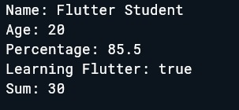

**Functions and Concepts Used:**
- `main()`
- `print()`
- `int`, `double`, `String`, `bool`
- `List`, `Map`
- `if-else`
- `for` loop
- User-defined functions

**Image Description:** Console output demonstrating Dart programming fundamentals, including variables, data types, operators, loops, conditional statements, and function execution.

### Experiment 2: Flutter Widgets and Layouts

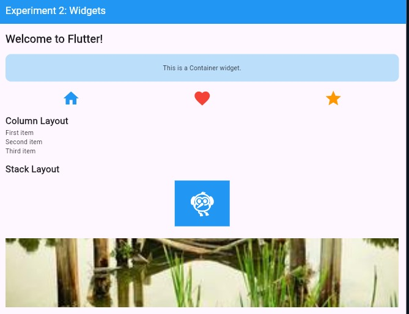

**Functions and Widgets Used:**
- `Text()`
- `Image`
- `Container()`
- `Row()`
- `Column()`
- `Stack()`
- `Scaffold()`

**Image Description:** A Flutter application screen demonstrating commonly used widgets such as Text, Image, Container, Row, Column, and Stack arranged together in a user interface.

### Experiment 3: Responsive UI Design

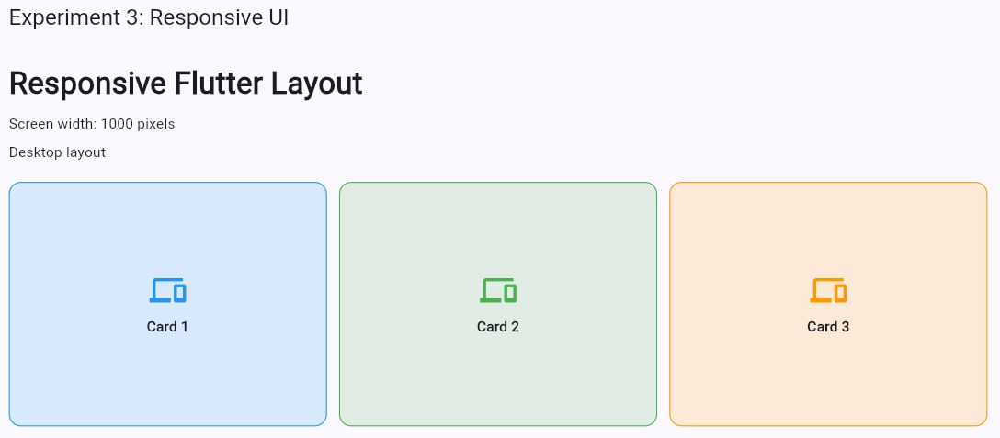

**Functions and Concepts Used:**
- `MediaQuery.of(context).size`
- `LayoutBuilder()`
- `BoxConstraints`
- Responsive breakpoints
- `OrientationBuilder()`

**Image Description:** A responsive user interface adapting to different screen sizes. The layout changes between a vertical Column arrangement on smaller screens and a horizontal Row arrangement on wider screens.

### Experiment 4: Navigation and Named Routes

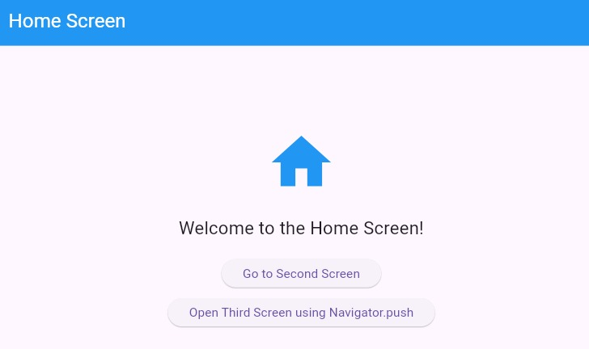

**Functions and Methods Used:**
- `Navigator.push()`
- `MaterialPageRoute()`
- `Navigator.pushNamed()`
- `Navigator.pop()`
- `routes`

**Image Description:** Flutter application demonstrating navigation between multiple screens using navigation buttons, named routes, and back navigation.

### Experiment 5: State Management

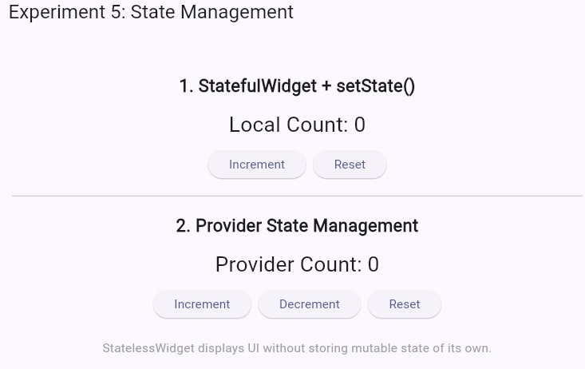

**Functions and Concepts Used:**
- `StatefulWidget`
- `StatelessWidget`
- `setState()`
- `ChangeNotifier`
- `notifyListeners()`
- `Provider`

**Image Description:** A counter application demonstrating state management. The displayed counter value updates dynamically when the increment and decrement buttons are pressed.

### Experiment 6: Custom Widgets and Styling

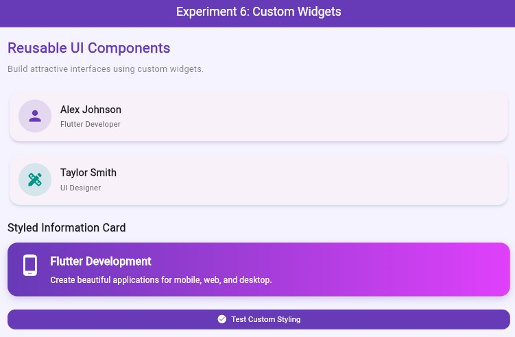

**Functions and Widgets Used:**
- Custom `StatelessWidget`
- `ThemeData()`
- `TextStyle()`
- `BoxDecoration()`
- `Container()`
- `Padding()`

**Image Description:** A Flutter screen displaying reusable custom widgets with consistent colors, typography, spacing, themes, and decorative styling.

### Experiment 7: Forms and Validation

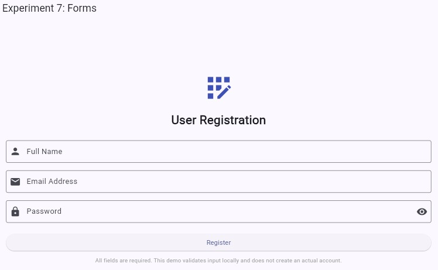

**Functions and Widgets Used:**
- `Form()`
- `GlobalKey<FormState>`
- `TextFormField()`
- `TextEditingController()`
- `validator:`
- `validate()`

**Image Description:** A form interface containing input fields and validation messages. It demonstrates user input handling and displaying error messages when entered information does not meet validation requirements.

### Experiment 8: Lists and Grid Views

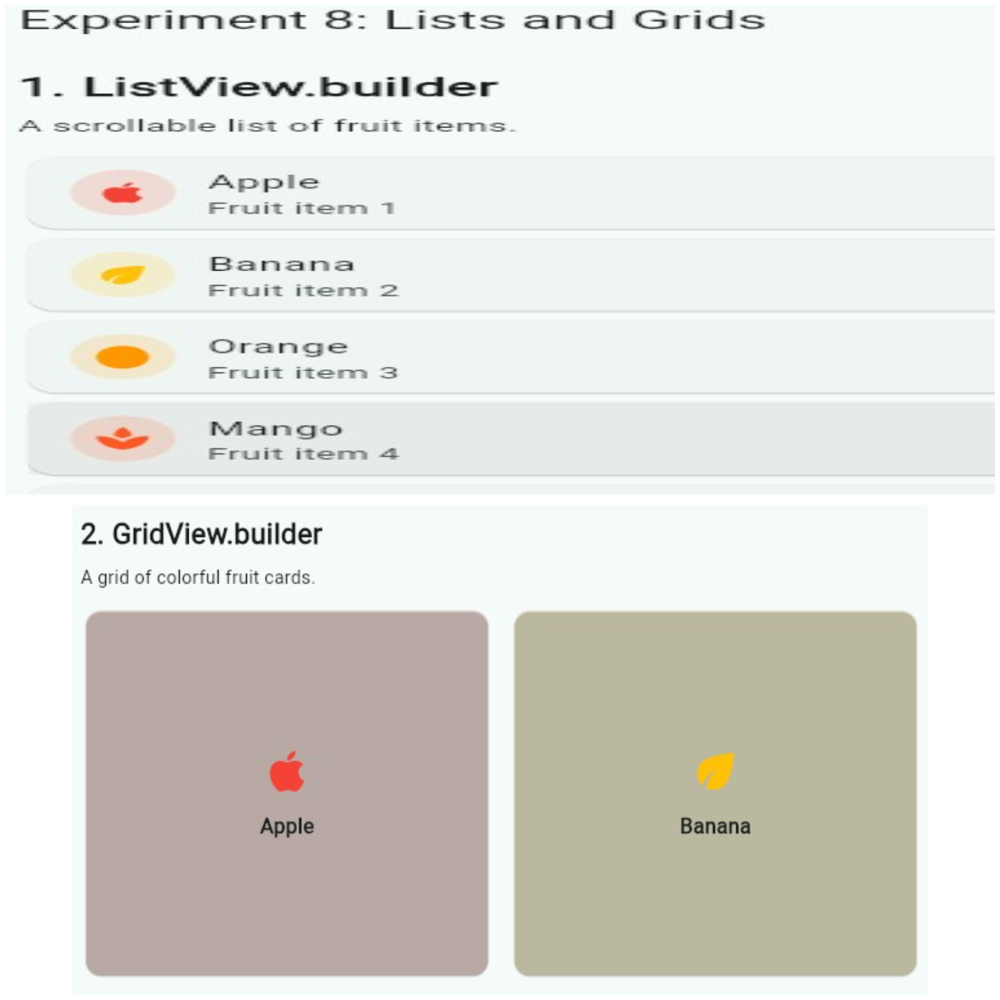

**Functions and Widgets Used:**
- `ListView.builder()`
- `GridView.builder()`
- `List.generate()`
- `itemBuilder`
- `itemCount`

**Image Description:** A Flutter interface demonstrating scrollable lists and a two-column grid layout containing dynamically generated cards or items.

### Experiment 9: REST API Integration

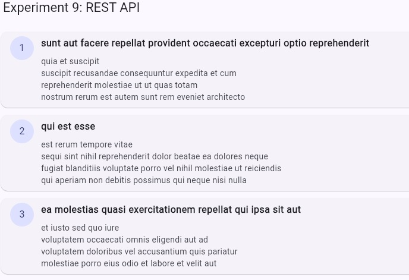

**Functions and Methods Used:**
- `http.get()`
- `async`
- `await`
- `jsonDecode()`
- `FutureBuilder()`
- `setState()`

**Image Description:** An application fetching data from a REST API and displaying the response. It demonstrates asynchronous HTTP requests, JSON parsing, loading indicators, and displaying retrieved data.

### Experiment 10: Local Data Storage

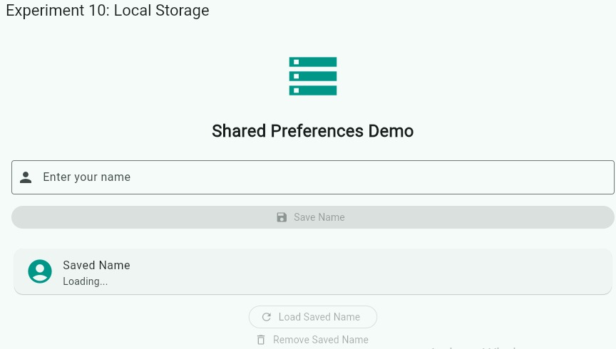

**Functions and Methods Used:**
- `SharedPreferences.getInstance()`
- `setString()`
- `getString()`
- `remove()`
- `clear()`

**Image Description:** A Flutter application demonstrating local data storage. Users can enter and save information, retrieve previously saved values, and maintain data across application restarts.

### Experiment 11: Flutter Animations

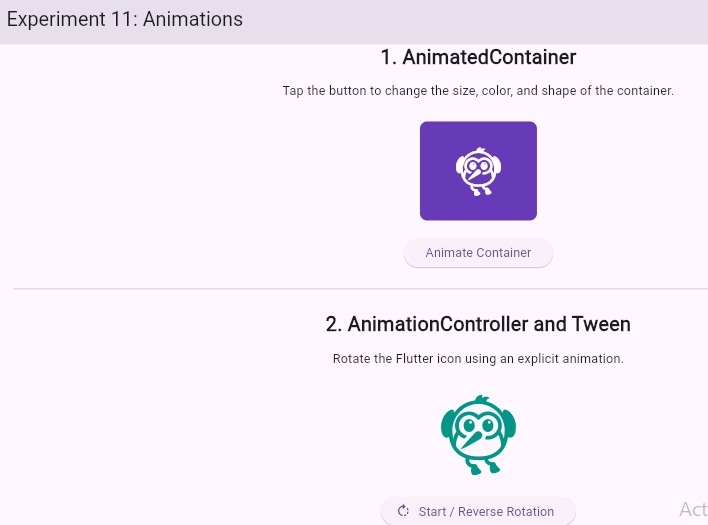

**Functions and Classes Used:**
- `AnimatedContainer()`
- `AnimationController`
- `Tween`
- `AnimatedBuilder()`
- `CurvedAnimation`
- `dispose()`

**Image Description:** An animated Flutter interface demonstrating changes in a widget's size, color, and shape through user interaction and animation controllers.

### Experiment 12: Flutter Mini Project

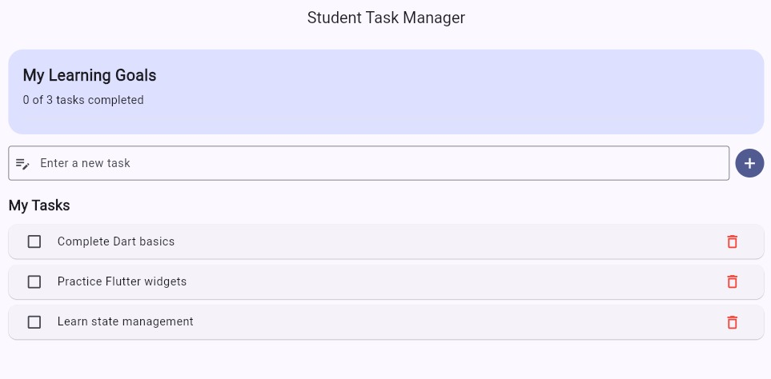

**Functions and Widgets Used:**
- `ListView.builder()`
- `TextEditingController()`
- `setState()`
- `Checkbox()`
- `IconButton()`
- `onPressed()`

**Image Description:** A Student Task Manager application that allows users to add tasks, view the task list, mark tasks as completed using checkboxes, and delete tasks.

## 🎯 Learning Objectives

- Understand Dart syntax and programming fundamentals.
- Build user interfaces using Flutter widgets.
- Create responsive layouts for different screen sizes.
- Implement navigation using Navigator and named routes.
- Manage application state using `setState` and Provider.
- Create reusable widgets and apply custom styling.
- Build forms with input validation.
- Display data using lists and grid layouts.
- Fetch and process data from REST APIs.
- Store application data locally.
- Implement animations in Flutter.
- Develop a mini project using Flutter concepts.

## 🛠️ Technologies Used

- **Dart** — Programming language.
- **Flutter** — Cross-platform UI framework.
- **Provider** — State management.
- **HTTP** — REST API communication.
- **Shared Preferences** — Local key-value storage.
- **Git and GitHub** — Version control and source-code hosting.
- **Visual Studio Code / Android Studio** — Development environments.

## 📋 Prerequisites

- Flutter SDK
- Dart SDK (included with Flutter)
- Visual Studio Code or Android Studio
- Git
- An Android emulator or supported device

## 🚀 Getting Started

### 1. Clone the Repository

```bash
git clone https://github.com/miryalkarvinay9346/flutter-dart-lab-experiments.git
cd flutter-dart-lab-experiments
```

### 2. Install Dependencies

Run the following command from the Flutter project directory containing `pubspec.yaml`:

```bash
flutter pub get
```

### 3. Run an Experiment

Run the selected Flutter experiment:

```bash
flutter run
```

Each Flutter experiment with its own `main()` function is intended to run separately.

Experiment 1 can be executed independently as a Dart program:

```bash
dart experiment_01_dart_basics.dart
```

## 📁 Repository Structure

```text
flutter-dart-lab-experiments/
├── screenshots/
│   ├── experiment_01_dart_basics.png
│   ├── experiment_02_flutter_widgets.png
│   ├── experiment_03_responsive_ui.png
│   ├── experiment_04_navigation.png
│   ├── experiment_05_state_management.png
│   ├── experiment_06_custom_widgets.png
│   ├── experiment_07_forms.png
│   ├── experiment_08_lists_grids.png
│   ├── experiment_09_api_integration.png
│   ├── experiment_10_local_storage.png
│   ├── experiment_11_animations.png
│   └── experiment_12_mini_project.png
├── experiment_01_dart_basics.dart
├── experiment_02_widgets_layouts.dart
├── experiment_03_responsive_ui.dart
├── experiment_04_navigation.dart
├── experiment_05_state_management.dart
├── experiment_06_custom_widgets.dart
├── experiment_07_forms.dart
├── experiment_08_lists_grids.dart
├── experiment_09_api_integration.dart
├── experiment_10_local_storage.dart
├── experiment_11_animations.dart
├── experiment_12_mini_project.dart
├── pubspec.yaml
└── README.md
```

## 📈 Learning Outcomes

By completing these experiments, learners gain practical experience in:

- Dart programming fundamentals.
- Flutter UI development and responsive design.
- Reusable widgets and custom layouts.
- Navigation and state management.
- Form handling and validation.
- REST API integration and asynchronous programming.
- Local data persistence.
- Animation techniques.
- Building a mini application using Flutter.

## 👨‍💻 Author

**Miryalkar Vinay**

GitHub: [@miryalkarvinay9346](https://github.com/miryalkarvinay9346)

An educational repository created to practise Flutter and Dart through hands-on laboratory experiments.

## 📄 License

This repository is intended for educational purposes.This repository is intended for educational purposes.
